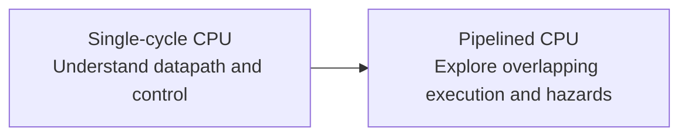

# RISC-V CPU in SystemVerilog

A learning-focused project to design a RISC-V CPU in **SystemVerilog** and understand how a processor works from instruction encoding to hardware execution.

The goal is to understand and explain each design choice, write RTL in small steps, and use simulation to check the resulting behavior.

## Architecture goals

The project starts with a **single-cycle CPU**, where each instruction completes within one clock cycle. Once that design is complete, the next goal is a **pipelined CPU**, where multiple instructions overlap across processing stages.

## Learning focus

- **Computer architecture:** instruction decoding, register files, arithmetic and logic, memory access, and control flow.
- **RTL design:** combinational and sequential logic, clocked state updates, and module interfaces.
- **Verification:** self-checking testbenches, waveform analysis, and debugging in simulation.
- **Pipelining:** instruction dependencies, hazards, and the tradeoffs involved in overlapping execution.

Design reasoning, examples, and verification decisions are recorded in the [study notebook](study/). The instruction subset and architecture details are chosen incrementally as the project develops.

## Tools and repository

**SystemVerilog · AMD Vivado · XSim**

- [Design sources](project/project.srcs/sources_1/new/) - CPU RTL.
- [Simulation sources](project/project.srcs/sim_1/new/) - testbenches.
- [Study notes](study/) - concepts and design decisions.
- [Vivado project](project/project.xpr) - project configuration.
